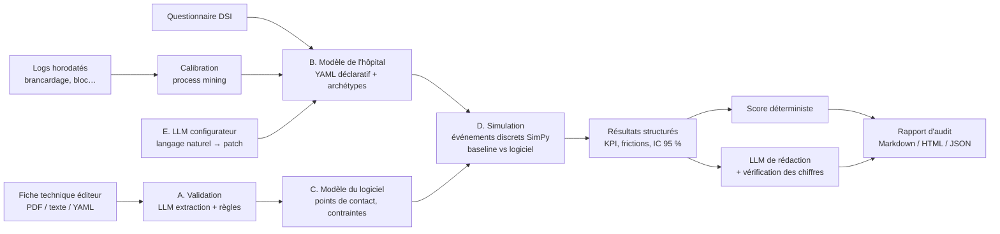

# BLOCAPTA

**Jumeau numérique hospitalier pour auditer la compatibilité d'un logiciel _avant_ son déploiement.**

Un éditeur propose un logiciel à un hôpital. Plutôt que de découvrir les problèmes après l'installation,
la DSI le fait passer dans une simulation de son établissement et obtient un rapport chiffré : où le logiciel
s'intègre bien, où il crée des frictions, combien de temps les équipes perdent ou gagnent, ce qu'il faut exiger
de l'éditeur.

> Cas d'origine : un outil de traçabilité qui n'enregistre **qu'un acte par saisie**, déployé auprès d'une
> chirurgienne qui réalise **plusieurs actes par intervention**. BLOCAPTA détecte ce type d'écart en simulant
> l'activité réelle du bloc. Cet exemple est fourni dans `examples/`.

---

## Architecture



**Principe directeur : les LLM ne simulent rien et n'inventent aucun chiffre.** Ils traduisent (document →
JSON, consigne → patch de configuration, résultats → texte). Le cœur est un moteur de simulation déterministe
et reproductible (graine fixée). Chaque nombre écrit par le LLM est vérifié contre les résultats ; en cas
d'écart, le rapport bascule sur une rédaction déterministe.

| Brique | Module | Rôle |
|---|---|---|
| A. Validation de la fiche | `blocapta.spec` | Extraction LLM → `SpecSheet`, critères YAML (bloquant / majeur / mineur), questions à l'éditeur |
| B. Modèle de l'hôpital | `blocapta.models.hospital`, `blocapta.configurator` | Ressources, horaires, parcours, tâches de documentation, SI ; héritage d'archétypes |
| Calibration | `blocapta.calibration` | Logs horodatés → variantes, durées ajustées (AIC, KS), arrivées, validation du jumeau |
| C. Modèle du logiciel | `blocapta.models.software` | Points de contact (tâche, rôles, éléments max par saisie, poste requis…), interfaces, licence |
| D. Simulation | `blocapta.simulation` | SimPy, ressources soumises à horaires, frictions, Monte Carlo, comparaison avec IC |
| E. Configurateur | `blocapta.configurator` | JSON Patch proposé par le LLM, revalidé, diff pour validation humaine |
| Rapport | `blocapta.reporting` | Score explicable, faits, rédaction vérifiée, rendu Markdown/HTML |
| Interfaces | `blocapta.api`, `blocapta.cli` | API REST FastAPI (`/docs`), CLI `blocapta` |

Détails : [`docs/architecture.md`](docs/architecture.md) · format des données : [`docs/donnees.md`](docs/donnees.md)
· choix du modèle LLM : [`docs/modeles_llm.md`](docs/modeles_llm.md)

### Frictions détectées

| Type | Exemple |
|---|---|
| `cardinalite` | 3 actes à tracer, le logiciel n'en accepte qu'1 par saisie → 2 saisies de contournement, risque d'oubli |
| `interoperabilite` | Pas de connecteur vers le DPI → double saisie |
| `couverture` | Le rôle qui fait la tâche (ex. IBODE) n'est pas prévu par le logiciel |
| `ressource` | Poste fixe requis alors que le lieu n'en a pas, ou attente d'un poste partagé |
| `disponibilite` | Tâche réalisée hors de la plage de service du logiciel |
| `charge` | Plus d'utilisateurs simultanés que la licence ne le permet |

---

## Démarrage rapide

```bash
git clone https://github.com/Tototra/BLOCAPTA.git && cd BLOCAPTA
python -m venv .venv && source .venv/bin/activate
make install          # pip install -e ".[dev,pdf]"
make test
make demo             # démo complète sans LLM → out/rapport_audit.md et .html
```

### Avec Ollama (LLM local)

```bash
# 1. Installer Ollama : https://ollama.com/download
ollama pull qwen3:8b
cp .env.example .env  # choisir les modèles
make demo-llm         # extraction depuis une brochure texte + rédaction LLM
```

Ou tout en conteneurs :

```bash
docker compose up -d --build   # API sur http://localhost:8000/docs, Ollama + téléchargement du modèle
```

---

## Utilisation

```bash
# 1. Remettre le questionnaire à la DSI
blocapta template -o questionnaire_dsi.md --answers reponses.yaml

# 2. Construire la configuration de l'hôpital à partir des réponses
blocapta apply-answers reponses.yaml -o hopital.yaml [--llm]

# 3. Calibrer les durées sur les exports horodatés, et vérifier que le jumeau colle à la réalité
blocapta calibrate export_brancardage.csv --mapping mapping.yaml --hospital hopital.yaml -o parcours.yaml

# 4. Ajuster la configuration en langage naturel (diff affiché, validation humaine)
blocapta configure hopital.yaml "On ouvre 2 salles de plus le jeudi et les brancardiers passent en 2x12h"

# 5. Valider une fiche technique éditeur
blocapta validate-spec fiche_editeur.pdf --hospital hopital.yaml

# 6. Audit complet
blocapta audit hopital.yaml fiche_editeur.pdf --days 20 --replications 30 -o out/rapport.md
```

Autres commandes : `archetypes`, `resolve`, `simulate`, `generate-log`, `serve`, `config`. Aide : `blocapta --help`.

### Adapter à un nouvel hôpital

1. Partir d'un archétype (`ch_general`, `chu`, `clinique_privee`) avec `extends:` et ne décrire que les différences.
2. Appliquer les réponses au questionnaire (`apply-answers`).
3. Calibrer sur les logs, valider le jumeau (`calibrate --hospital`) : écart ≤ 10 % sur la durée de parcours et
   le volume journalier.
4. Affiner par consignes en langage naturel (`configure`) : chaque modification est un patch versionnable.

Ajouter un archétype = déposer un YAML dans `src/blocapta/data/archetypes/`.
Ajouter un critère de fiche technique = éditer `src/blocapta/data/criteria.yaml`.

---

## Structure du dépôt

```
src/blocapta/
  models/          schémas Pydantic (lois, hôpital, logiciel, fiche technique, résultats)
  spec/            validation des fiches techniques (règles + extraction LLM)
  calibration/     journaux d'événements, process mining, ajustement de lois
  simulation/      moteur SimPy, Monte Carlo, analyse statique, validation du jumeau
  configurator/    archétypes, héritage, JSON Patch, LLM configurateur, questionnaire
  reporting/       score, faits, rédaction vérifiée, rendu
  llm/             client Ollama (sorties structurées), FakeLLM
  api/ cli.py      interfaces
  data/            archétypes, critères, questionnaire, gabarits de rapport
examples/          fiche ArchivActes, hôpital d'exemple, réponses au questionnaire
tests/             tests unitaires et de bout en bout (sans LLM)
docs/              architecture, données, modèles LLM
```

## Limites actuelles et feuille de route

- Les valeurs des archétypes sont des ordres de grandeur **non calibrés** : elles doivent être remplacées par
  les données de l'établissement.
- Pas de préemption (une urgence ne déloge pas une intervention en cours) ni de priorités entre patients.
- Les tâches de documentation sont modélisées en fin d'étape ; les tâches pendant l'étape restent à ajouter.
- Prochaines étapes : parcours à variantes (routage probabiliste), mode « bac à sable » qui rejoue des messages
  HL7/FHIR synthétiques vers le vrai logiciel, interface web, export PDF.
