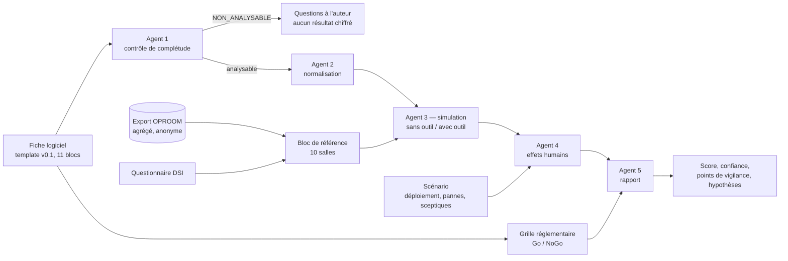

# BLOCAPTA

**Jumeau numérique de bloc opératoire pour tester un logiciel _avant_ de le déployer.**

Aujourd'hui, un outil numérique arrive au bloc sans avoir été essayé sur l'organisation réelle. Il peut
ralentir les équipes, les surcharger ou créer de nouveaux risques, et l'on ne s'en aperçoit qu'une fois
l'outil en place. Blocapta permet à un bloc de répondre, avant d'acheter ou de déployer un outil, à trois
questions : **que va-t-il changer, pour qui, et quels risques crée-t-il ?**

> Cas d'origine : un outil de traçabilité qui n'enregistre **qu'un acte par saisie**, déployé auprès d'une
> chirurgienne qui réalise **plusieurs actes par intervention**. Blocapta détecte ce type d'écart en simulant
> l'activité réelle du bloc (exemple `examples/fiches/archivactes.yaml`).

Blocapta aide à décider : il ne remplace ni l'avis des soignants ni un essai réel en conditions contrôlées.

---

## La chaîne d'analyse



**Principe directeur : les LLM ne simulent rien et n'inventent aucun chiffre.** Ils lisent une fiche (PDF,
Word, texte → JSON), proposent des modifications de configuration et rédigent le rapport. Le cœur est un
moteur de simulation déterministe et reproductible (graine fixe, mêmes patients dans les deux scénarios).
Chaque nombre écrit par un LLM est vérifié contre les résultats de simulation.

| Étape | Module | Ce qu'elle fait |
|---|---|---|
| Fiche logiciel | `models/fiche.py` | Format machine du template v0.1 : identité, contexte, acteurs, périmètre, processus avant/après, données, fiabilité, déploiement, risques, preuves, indicateurs |
| Agent 1 | `spec/completeness.py` | Grille de 40 champs (25 O, 12 R, 3 F), 4 champs critiques, contrôles de cohérence, verdict `NON_ANALYSABLE` / `ANALYSABLE_AVEC_RESERVES` / `ANALYSABLE`, confiance, 10 questions priorisées |
| Réglementaire | `data/criteria.yaml` | RGPD + AIPD, HDS si hébergé dehors, traçabilité des accès, INS, TLS/RBAC/flux, PCA/PRA, CE si DM, interopérabilité |
| Agent 2 | `spec/normalize.py` | Bloc 4 → points de contact du jumeau ; incertitude selon le niveau de preuve ; périmètre ; hypothèses tracées |
| Bloc de référence | `reference.py`, `data/reference/` | 10 salles, effectifs et horaires réels, équipements, durées par spécialité, programme opératoire, urgences |
| Agent 3 | `simulation/engine.py` | Simulation à événements discrets (SimPy) : une personne à un seul endroit, MAR limité à 2 patients, pré-anesthésie, bionettoyage, SSPI, règle de fin, frictions |
| Agent 4 | `simulation/human.py` | Confiance par soignant, aversion à la perte, influence des collègues, apprentissage, pannes, contournement |
| Agent 5 | `reporting/` | Score explicable, niveau de confiance, points de vigilance, hypothèses, paramètres à calibrer, rédaction vérifiée |

### Fidélité au bloc réel

Le bloc simulé **sans outil** retrouve les chiffres de l'export OPROOM (janvier à octobre 2026) à moins de
10 % près — verdict **GO** du test n° 1 du cahier des charges :

| Indicateur | Réel | Simulé (IC 95 %) |
|---|---:|---:|
| Interventions réalisées par jour ouvré | 32,4 | 32,3 [31,5 ; 33,2] |
| Taux d'annulation | 15,8 % | 16,2 % |
| Taux d'occupation des salles | 47 % | 50,1 % |
| Heure du premier cas | 8 h 40 | 8 h 30 |
| Durées médianes (8 spécialités) | 17 à 113 min | toutes à moins de 5 % |
| Contrôle d'ubiquité, durées négatives | — | 0 |

Détail et méthode : [`docs/fidelite.md`](docs/fidelite.md).

---

## Démarrage rapide

```bash
git clone https://github.com/Tototra/BLOCAPTA.git && cd BLOCAPTA
python -m venv .venv && source .venv/bin/activate
make install        # pip install -e ".[dev,pdf]"
make test
make demo           # fidélité + agent 1 + deux audits complets, sans LLM → out/
make scenarios      # les scénarios fil rouge du cahier des charges
```

Exemples de rapports produits : [`docs/exemples/`](docs/exemples/).

### Avec Ollama (LLM local)

```bash
ollama pull qwen3:8b            # https://ollama.com/download
cp .env.example .env
make demo-llm                   # extraction d'une brochure en texte libre + rédaction du rapport
```

Ou tout en conteneurs : `docker compose up -d --build` (API sur http://localhost:8000/docs).
Choix du modèle : [`docs/modeles_llm.md`](docs/modeles_llm.md).

---

## Utilisation

```bash
# 1. L'éditeur (ou le cadre) remplit la fiche logiciel
blocapta fiche-template -o fiche.yaml
blocapta fiche fiche.yaml --no-llm                  # agent 1 + Go/NoGo réglementaire
blocapta fiche brochure.pdf --save-fiche fiche.yaml # extraction par LLM d'un document libre

# 2. Décrire le bloc de l'établissement (sinon : bloc de référence)
blocapta template -o questionnaire.md --answers reponses.yaml
blocapta apply-answers reponses.yaml -o mon_bloc.yaml
blocapta configure mon_bloc.yaml "On ouvre une 11e salle le jeudi" --apply
blocapta fidelite --hospital mon_bloc.yaml          # Stop/Go avant tout test de logiciel

# 3. Tester le logiciel
blocapta simulate mon_bloc.yaml --software fiche.yaml --scenario examples/scenarios/panne_precoce.yaml
blocapta audit mon_bloc.yaml fiche.yaml -o out/rapport.md      # rapport Markdown + HTML + JSON
```

Autres commandes : `reference` (reconstruire le bloc de référence), `calibrate`, `generate-log`,
`archetypes`, `resolve`, `serve`, `config`. Aide : `blocapta --help`.

### Scénarios fil rouge (`examples/scenarios/`)

| Scénario | Question | Ce que montre le jumeau |
|---|---|---|
| `deploiement_lundi_8h` | Effet du déploiement le premier mois ? | courbe d'apprentissage, temps de saisie qui baisse semaine après semaine |
| `panne_precoce` / `_avec_support` | La confiance remonte-t-elle après une panne au 2e jour ? | chute durable sans support, remontée plus rapide avec support sur site |
| `chirurgien_sceptique` / `champion` | La réticence d'un senior se propage-t-elle ? | l'équipe est freinée ; un champion compense en partie |

---

## Données et confidentialité

- **Aucune donnée de patient.** L'export OPROOM n'est **jamais** versionné : `tools/oproom_aggregate.py`
  supprime les colonnes nominatives (chirurgiens, anesthésistes), filtre les valeurs aberrantes et ne
  produit que des statistiques agrégées (`data/reference/oproom_stats.json`).
- L'agent 1 bloque toute fiche contenant une donnée personnelle, sans la recopier.
- Les LLM tournent en local (Ollama) : rien ne sort de l'infrastructure.
- Chaque paramètre non mesuré est marqué **« à calibrer »** et listé dans les rapports.

Détails : [`docs/donnees.md`](docs/donnees.md) · Architecture : [`docs/architecture.md`](docs/architecture.md) ·
Facteur humain : [`docs/facteur_humain.md`](docs/facteur_humain.md)

## Structure du dépôt

```
src/blocapta/
  models/          hôpital, lois de probabilité, fiche logiciel, logiciel, scénario, résultats
  spec/            agent 1 (complétude), grille réglementaire, agent 2 (normalisation), extraction
  simulation/      moteur, facteur humain, Monte Carlo, fidélité
  reference.py     construction du bloc de référence
  configurator/    archétypes, héritage, patchs, LLM configurateur, questionnaire DSI
  reporting/       score, faits, rédaction vérifiée, rendu Markdown / HTML
  calibration/     journaux horodatés, process mining, ajustement de lois
  llm/  api/  cli.py
  data/            archétypes, référence agrégée, effectifs, grilles, questionnaire, gabarits
examples/          fiches (ArchivActes, ScanTrace), scénarios, questionnaire
tools/             agrégation anonyme de l'export OPROOM
docs/              architecture, données, fidélité, facteur humain, modèles LLM, exemples
```

## Limites et suite

- Paramètres humains (α, κ, confiance initiale) **à calibrer** : les résultats humains sont des tendances.
- Les horodatages du parcours (pré-anesthésie, SSPI) sont presque vides dans l'export actuel : leurs durées
  sont supposées. Le questionnaire (section G) liste les données à recueillir.
- La définition OPROOM du taux d'occupation est à confirmer avec le cadre de bloc.
- Prochaines étapes : planning réel des vacations, absentéisme et pauses, brancards en stock fini,
  lits d'aval, tableau de bord interactif, relecture par 5 professionnels du bloc (test n° 3).
